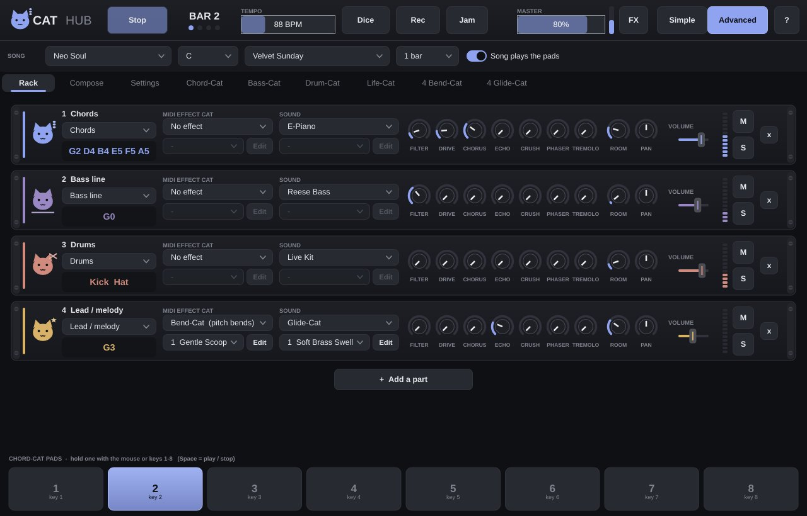

# Cat Hub

One window where **all the Cats jam together** without Cubase (Windows and Linux).

Press **Play**: the Hub walks through Chord-Cat's pads, Bass-Cat plays a bass line to the chords, Drum-Cat the drums and Life-Cat's creatures sing along, all at one tempo.
- **Rack**: one row per part (up to 8). Each part takes notes from the chords, the bass line, the drums, Life-Cat's creatures or a lead line (the chords' top note), plays them with a built-in sound (pads, e-piano, pluck, strings, 4 basses, 4 drum kits) or a **sound Cat** (Glide-, Sing-, Talk-Cat) with all of its presets, and can run them through a **MIDI-effect Cat** first (Patt-Cat patterns, Bend-Cat bends, Orbit-Cat arpeggios).
- **Advanced mode**: filter, drive, chorus, echo, crush, **phaser**, **tremolo** (1/8 notes, moving between left and right), room and pan on every part, "+ Add a part". **Simple mode** shows just sound, preset, volume and what is playing.
- **Song bar**: 10 styles (Lo-fi Study, Trap Night, House Party, Neo Soul, Ambient Garden, Afro Sun, Rock Anthem, Jazz Cafe, Choir & Cats...), key, chord progression (every Chord-Cat preset), chord length.
- **Dice** and the **Compose** tab write whole songs that sound good (see *The composer* below): pick a genre (Pop, Lo-fi, Trap, House, Ambient, Jazz, Rock, Cinematic, Frutiger Aero, Synthwave, Bossa nova, Chiptune, Orchestral, City pop, Reggae, Folk, Dream pop, Funk) and a mood (Happy, Sad, Dark, Dreamy, Epic, Chill), press **Write a song!** and every part in the rack plays it: chords, bass line, drums, the melody (Lead) and a counter-melody. **Song** or **Endless** (it keeps writing new parts while it plays). **New: Chords / Bass / Drums / Melody / Counter-melody / Lyrics / Song form** renews one thing and keeps the rest. A map shows every section, chord and note with the playhead; the words scroll along, and Sing-Cat or Talk-Cat on the Lead part sings them. **Export**: the song as a WAV, one WAV per part (stems) or a MIDI file (*Music\\Cat Hub*). Every song has a number: the same number, genre and mood always give the same song.
- Every Cat's own window is a tab (centred, scaled to fit). **Settings**: 6 themes (Midnight, Ocean, Sunset, Forest, Candy, Paper), sound card, which Cats were found, the tutorial again.
- **Instruments**: besides pads, e-piano, plucks, strings, chip and glass bells there is a modelled **Piano** (stiff strings with their own decays, two strings beating, a felt hammer) and a **Nylon Guitar** (a plucked Karplus-Strong string), also in Muse-Cat and Cat Ocean.
- **Song arranger**: click a section on the Compose map: other chords for it, make it a verse / chorus / bridge ..., 4 / 8 / 12 / 16 bars, which parts play, more or less energy, add a section after it, play it twice, move it, remove it, undo. Every part is re-written to fit and it still sounds like the same song.
- **Jam** menu: **Save jam / Open jam** (`Ctrl+S` / `Ctrl+O`, a *.catjam* file with everything: the Cats' settings, parts, sounds, effects, the song and its arrangement; in *Documents\\Cat Hub jams*), start a fresh jam, **full screen** (`F11`, `Esc` leaves). The window can be any size.
- **FX** (next to Master): master effects for the whole mix: **Room** (the shared reverb), **Tone** (darker / brighter), **Glue** (a gentle compressor, with a meter), **Warmth** (tape saturation), **Width** (mono ... extra wide), **Pump** (the mix ducks on every beat, like a side-chained kick) and **Vinyl** (crackle, hiss, a softer top).
- **Piano roll** (`P`, or Jam - Loop recorder): see the loop's notes and edit them: click to draw (pick the length: 1/16 ... 1 bar), drag to move, drag the end to stretch, double- or right-click to delete, Quantize, Clear. Notes you draw are one take (*Undo the last take* removes them). The loop is saved in the jam.
- **MIDI keyboard**: plug one in and play: the notes go to the Lead part (or the part you pick in Settings - *MIDI keyboard plays*), with its sound and effects. Turn keyboards on / off under Settings - Sound card.
- A short **tutorial** on the first start, **Rec** to a WAV in *Music\\Cat Hub*, `Space` = play / stop, `1`-`8` = hold a pad. Everything (incl. each Cat's settings) is remembered.

See also: [The composer](../Composer.md) · [Cat Link](../Cat-Link.md)
