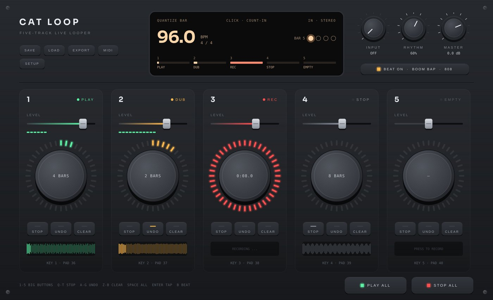

# Cat Loop

A **5-track live looper**, like a Boss RC-505, as a program on its own (Windows, Mac, Linux). No DAW needed: plug in a mic, a guitar or a keyboard, press the big button, play, press again, and build a song on top of it, live.

## Playing it
- **The big button** of a track (or keys **1 - 5**, or pads **36 - 40** on a MIDI controller): EMPTY → **REC** → **PLAY** → **DUB** (play more on top) → PLAY → DUB ...
- **STOP** (Q W E R T), **UNDO** (A S D F G; again = REDO), **CLEAR** (Z X C V B). **Space** = play / stop everything, **Backspace** = undo the last track.
- The LED ring shows where the loop is; the little picture under the buttons is the loop itself.
- **PLAY ALL / STOP ALL** at the bottom right.

## Tempo, click and beat
- **The first loop sets the tempo**: it becomes 1, 2, 4, 8 ... bars between 70 and 140 BPM. Or set the tempo yourself first: drag the BPM up / down, press **Enter** to tap it, or click it for its menu (beats in a bar, type a tempo).
- After that, every loop **starts and ends on the bar** (QUANTIZE: Bar, Beat or Off), so they always stay together. Press a little late or early: it lands on the nearest bar line.
- **CLICK**: Off, **Count-in** (one bar of clicks before the first loop) or Always.
- **BEAT** (key B): a drum beat under everything, 13 styles (Boom Bap, Dilla, Trap, House, Afrobeats ...) and 4 kits; right-click it for the style, the kit and a new pattern. It starts on the bar.
- Knobs: **INPUT** (hear what comes in - leave it OFF if your sound card already lets you hear it, or with a mic and speakers), **RHYTHM** (beat + click), **MASTER**. Every track has its own LEVEL fader.

## MIDI controller
Pads 36 - 40 are the big buttons, 41 play / stop all, 42 undo, 43 beat, 44 - 48 stop (the two pad banks of controllers like the M-Audio Oxygen Pro Mini). To change any of them: **MIDI** (it lights up) → click a button in Cat Loop → press a pad, key or button (notes and CCs both work) → **MIDI** again.

## Setup, saving, export
- **SETUP**: your **sound card** (pick its input, for example *Input 1* for a guitar), MIDI devices, **latency** (Auto uses what the sound card reports, so overdubs land where you heard them; or set it in ms), and what happens after REC (play, or go straight on to overdub).
- **SAVE / LOAD**: the whole set (all loops, the tempo, the beat) in one `.catloop` file.
- **EXPORT**: the mix as a `.wav`, or every track as its own `.wav` (stems, all the same length) to drag into your DAW. Right-click a track's big button to save just that loop.

## Tips
- Start with the beat (B) and the click on Count-in: the first loop then lands exactly on the bars.
- Record a short loop first (1 or 2 bars: chords, a bass line), then longer ones on the other tracks (4 or 8 bars: a melody).
- With a mic and laptop speakers, keep INPUT at OFF (no howling).

---
[All the docs](../README.md) · [Install](../Install.md) · [FAQ](../FAQ.md)
