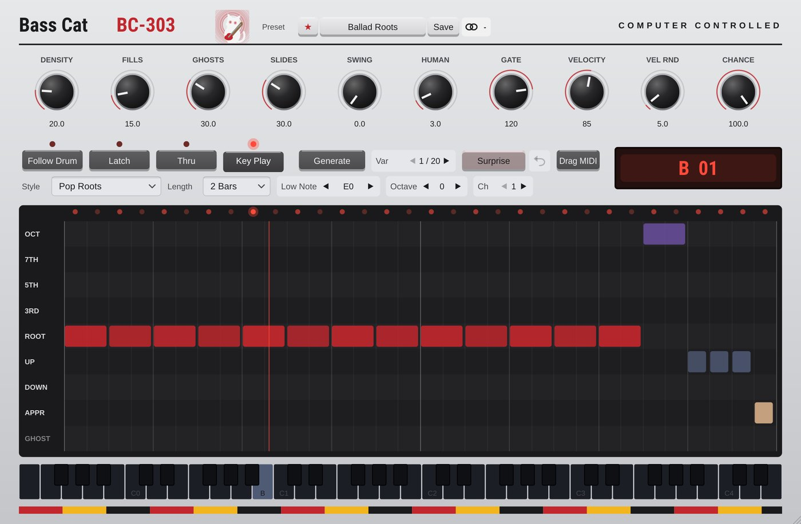

# Bass-Cat

**MIDI** · Bass lines that follow your chords, in 18 styles.

## What it does

Bass lines that follow the chord you hold (or Chord-Cat's MIDI Out): finds the root (also of inversions), 18 styles (Pop Roots, Walking, Neo Soul, Funk, Boom Bap, Dilla, 808 with slides, Reggae, House, Disco Octaves, Latin, Drone, Rock, Dub, Country, Afrobeats, Drill, Synth Arp), written in chord degrees so they follow every chord change; ghost notes, fills, slides, 20 variations per seed, editable degree grid, Follow Drum, 24 presets, drag-and-drop MIDI.

## In Cubase

MIDI Cats load as **instruments** (Cubase's MIDI insert slots only take Steinberg's own plug-ins). See [Using it in Cubase](../Cubase.md) for the routing.

---
[All plug-ins](../README.md) · [Install](../Install.md) · [Every Cat can ...](../Every-Cat.md)
