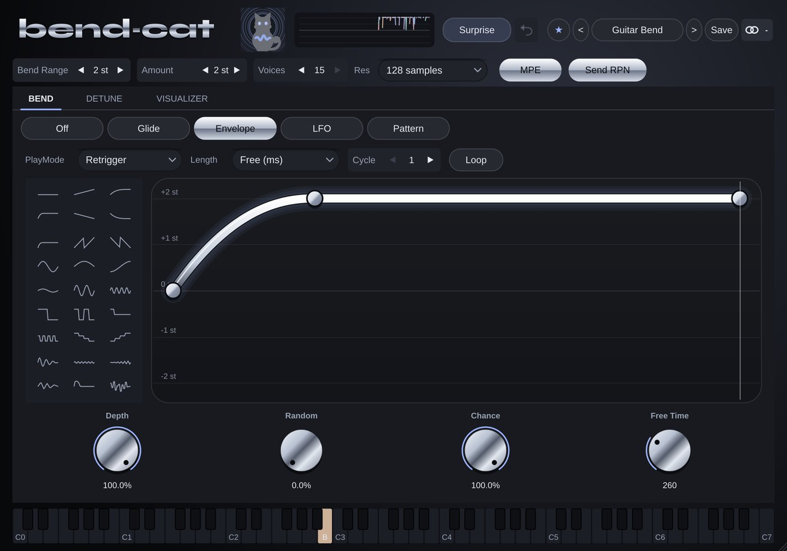

# Bend-Cat

**MIDI** · Per-voice pitch bends over MPE: glides, shapes, LFOs, human drift.

## What it does

Per-voice pitch-bend expression over MPE: glide, 27-shape envelope editor, LFO, 16-step bend pattern, human detune and drift, Scala microtuning, live visualiser, 25 expression presets.

## In your DAW

MIDI Cats load as **instruments with a MIDI output**: the DAW sends that MIDI to your synth (in Cubase, MIDI insert slots only take Steinberg's own plug-ins). See [Using it in your DAW](../DAW.md) for the routing.

---
[All plug-ins](../README.md) · [Install](../Install.md) · [Every Cat can ...](../Every-Cat.md)
