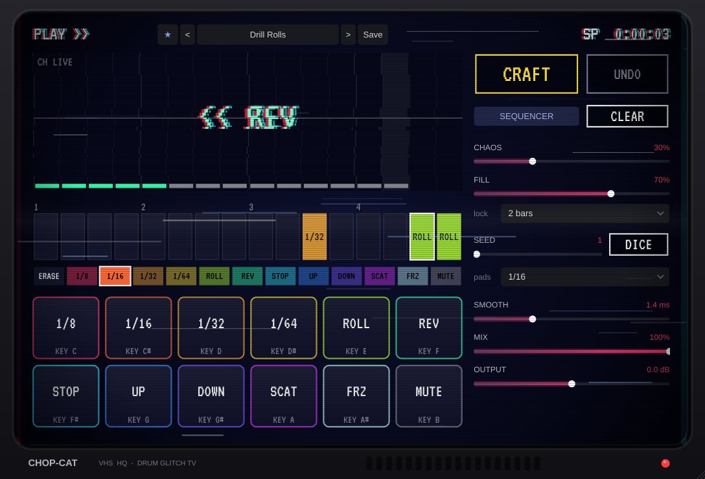

# Chop-Cat

**Effect** · Glitches drums (or anything) in time - and looks like an old TV playing a worn VHS tape.

## What it does

> An audio effect. Put it on a drum track (or a bus). The picture tears and shakes whenever the sound glitches.

It keeps recording the last 4 seconds; a **glitch** plays a piece of that memory instead of the live sound:

| Glitch | What you hear |
|---|---|
| **Repeat 1/8, 1/16, 1/32, 1/64** | the same bit again and again (1/64 = a buzz) |
| **Roll** | repeats that get faster and faster (a trap hi-hat roll) |
| **Reverse** | what just played, backwards |
| **Tape Stop** | slows down to a stop |
| **Pitch Up / Down** | the last step an octave up (twice as fast) or down |
| **Scatter** | an earlier step of the bar - the beat gets shuffled |
| **Freeze** | the moment, frozen into a smear |
| **Mute** | silence |

Three ways to start them (the stronger wins):

- **12 live pads**: hold one and the glitch plays; slide to another. **MIDI keys C .. B** (any octave) hold the same pads - draw them into a MIDI track in Cubase and route it to Chop-Cat. **PADS** quantize waits for the next 1/16 or 1/8.
- **The sequencer**: 16 steps; pick a glitch in the brush row and paint it on the steps (click it again to erase, right-click for a list). The same glitch on neighbouring steps runs on as one.
- **CHAOS**: random glitches, always in time. **FILL** puts more at the end of the bar (like a drummer's fill), **LOCK** repeats the same ones every 1, 2 or 4 bars (it grooves), **SEED / DICE** picks other ones.

**SMOOTH** sets how softly a glitch starts and stops, **MIX** how much you hear.

24 presets (Drill Rolls, Trap Hats, Breakcore Blender, IDM Scatter, Lo-fi Tape, DnB Edits, Hyperpop, Vaporwave, Machine Gun ...), **CRAFT** makes a whole new glitch style with a made-up tape name, **UNDO** goes back.

---
[All plug-ins](../README.md) · [Install](../Install.md) · [Every Cat can ...](../Every-Cat.md)
