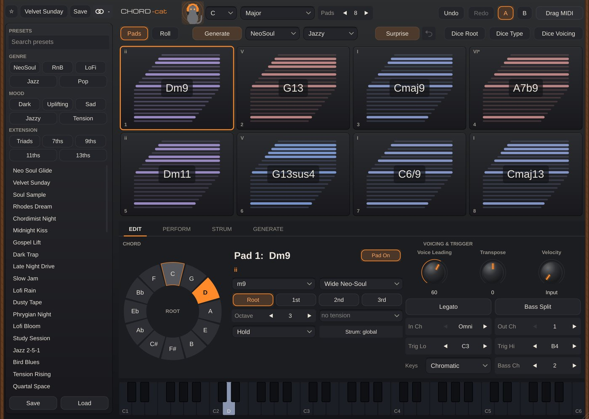

# Chord-Cat

**MIDI** · One-finger chord progressions: 16 pads, voice leading, strum, a progression generator.

## What it does

One-finger chord progressions: 16 pads, 80 chord types, 48 scales, 9 voicing models with voice leading, strum / humanise / groove, Markov progression generator, substitutions, MIDI capture, drag-and-drop MIDI, 48 factory progressions.

## In Cubase

MIDI Cats load as **instruments** (Cubase's MIDI insert slots only take Steinberg's own plug-ins). See [Using it in Cubase](../Cubase.md) for the routing.

---
[All plug-ins](../README.md) · [Install](../Install.md) · [Every Cat can ...](../Every-Cat.md)
