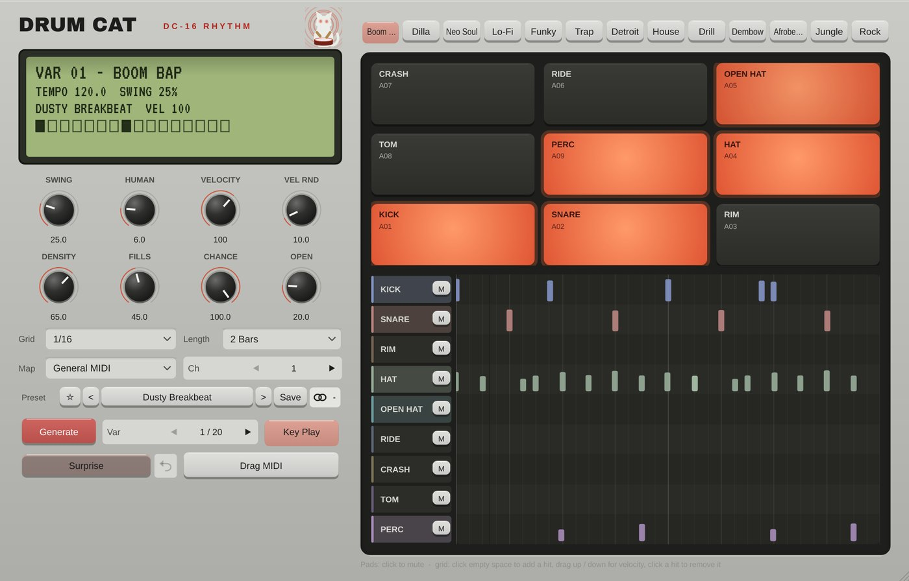

# Drum-Cat

**MIDI** · Drum patterns in 13 styles with hand-played timing and ghost notes.

## What it does

Drum pattern generator: 13 style models (Boom Bap, Dilla, Neo Soul, Lo-Fi, Funky, Trap, Detroit, House, Drill, Dembow, Afrobeats, Jungle, Rock) with hand-played micro-timing and ghost notes; 9 lanes, 20 variations per seed, editable groove grid, swing / human / velocity / chance / open hats, GM or sequential drum maps, drag-and-drop MIDI, 40 groove presets.

## In your DAW

MIDI Cats load as **instruments with a MIDI output**: the DAW sends that MIDI to your synth (in Cubase, MIDI insert slots only take Steinberg's own plug-ins). See [Using it in your DAW](../DAW.md) for the routing.

---
[All plug-ins](../README.md) · [Install](../Install.md) · [Every Cat can ...](../Every-Cat.md)
