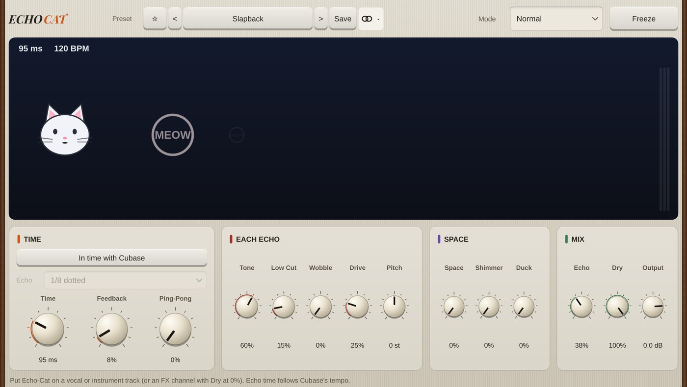

# Echo-Cat

**Effect** · Tape echo and space: ping-pong, duck, freeze, reverse.

## What it does

> Audio effect.

An echo and space for vocals, synths and the other Cats: tape echo in time with Cubase (1/32 ... 1 bar, dotted and triplet) or free in ms, feedback, **ping-pong**, and each echo darker (Tone), thinner (Low Cut), wobblier (Wobble, old tape) and warmer (Drive); **Duck** (the echoes step back while you sing and come up in the gaps), **Freeze** (hold the echoes forever), **Space** (a big soft room) with **Shimmer** (the room rings an octave higher). Echo modes: **Reverse** (each echo plays backwards), **Steps** (draw a rhythm of 8 echoes, each with its own level) and **Pitch** (each echo up to 12 semitones higher or lower than the last). An animated cat meows and its echoes fly across the screen. 24 presets (Dotted Eighth, Slapback, Ping-Pong Party, Vocal Polish, Ducked Vocal Echo, Tape Space, Lo-fi Cassette, Dub Siren, Underwater, Shimmer Cathedral, Ambient Wash, Backwards Dream, Rising Stairs, Octave Down Dub, Gallop Steps, Bouncing Ball ...). Put it on a track's insert, or on an FX channel with Dry at 0%.

---
[All plug-ins](../README.md) · [Install](../Install.md) · [Every Cat can ...](../Every-Cat.md)
