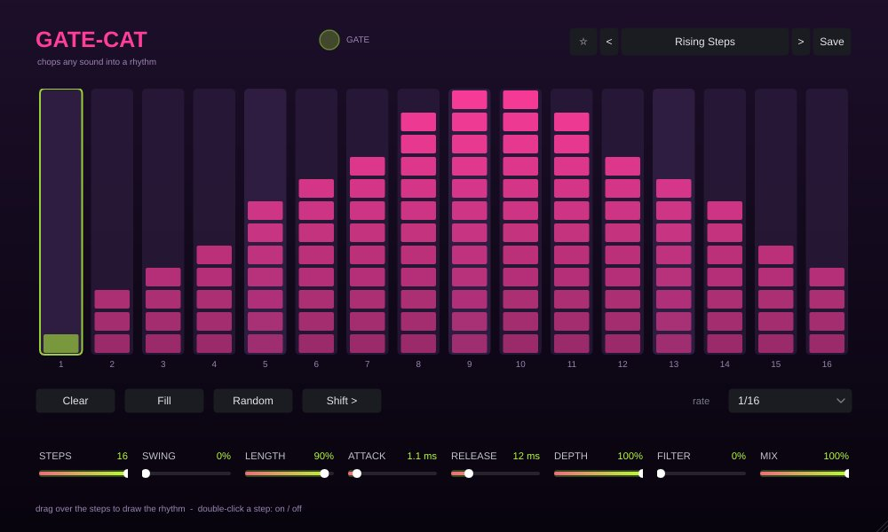

# Gate-Cat

**Effect** · Chops any sound into a rhythm: the trance gate.

## What it does

> Audio effect (VST3 > Dynamics). Put it on a pad, a choir, a long synth chord or a whole group.

A gate opens and closes the sound. Gate-Cat does it in a rhythm you draw, locked to your DAW: a held pad becomes a pulsing trance pattern, a chord becomes a stutter.

- **16 steps**: drag up / down over them to draw how loud each step is; double-click a step to turn it fully on / off. **Clear**, **Fill**, **Random** (always hits the beats) and **Shift >** (move the pattern one step).
- **RATE**: how long one step is (1/4 .. 1/32, 1/8 and 1/16 triplets). **STEPS**: how long the pattern is (12 for triplets).
- **SWING**: every second step comes later - a groove instead of a machine.
- **LENGTH**: how much of each step stays open (short = choppy, long = smooth). **ATTACK** / **RELEASE**: how fast a step opens and closes (slow = it breathes).
- **DEPTH**: how deep the holes are (0 = nothing happens). **FILTER**: quieter steps also get darker, like a filter opening in the rhythm. **MIX**.
- Without the DAW playing it keeps chopping on its own clock (at the last tempo).

16 presets: Trance Pulse, Classic Trance Gate, Offbeat Pump, Sidechain Feel, Stutter 1/32, Triplet Gallop, Swing House, Breathing Pad, Morse Code, Filter Steps, Dark Chop, Soft Tremolo, Half Time, Glitch Grid, Rising Steps, Subtle Groove.

**Tips:** a big pad through **Classic Trance Gate**; **Sidechain Feel** on a pad for the "pumping" sound without a compressor; **Filter Steps** on a bass; **Stutter 1/32** automated for one beat before a drop.

---
[All plug-ins](../README.md) · [Install](../Install.md) · [Every Cat can ...](../Every-Cat.md)
