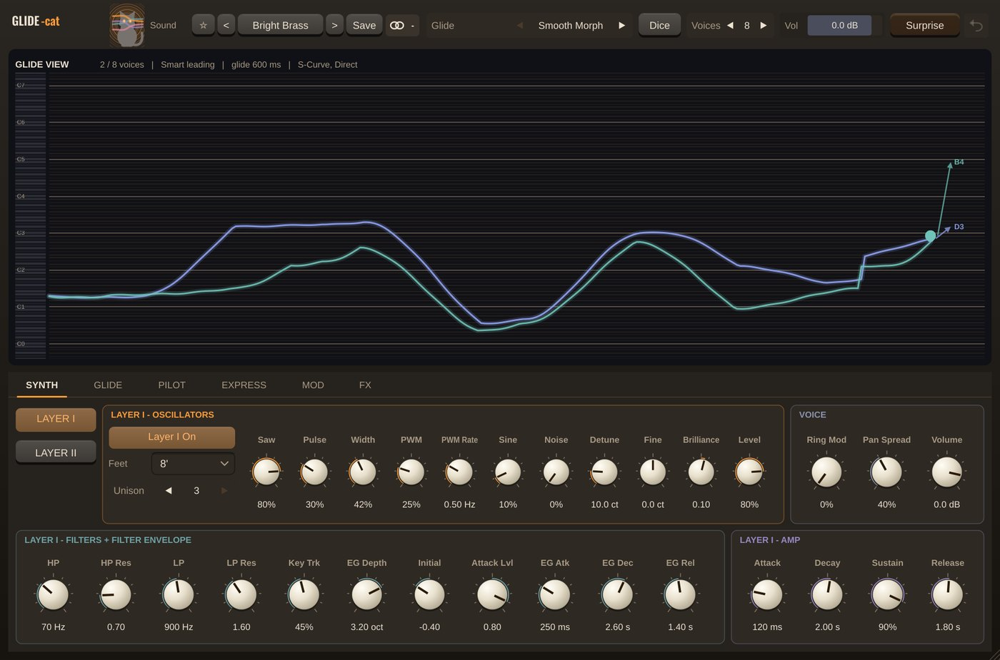

# Glide-Cat

**Instrument** · A poly synth whose voices glide from chord to chord.

## What it does

> Instrument (makes sound).

Polyphonic synth (up to 16 voices) whose voices glide from chord to chord instead of restarting: Smart (smallest total movement) or Classic voice leading, extra notes Branch off a voice or start Fresh, spare voices merge, lines remembered after release. Glide by Time or Rate, 5 curves (incl. Elastic and Semitone Stairs), 5 paths (Arc, Zigzag, Swirl), start directions, stagger orders, release bends. Two layers per voice (detuned saws, PWM pulse, sine, noise, HP + resonant LP with initial / attack-level filter envelope, amp envelope, ring mod), auto swell / brighten / drift / delayed vibrato, MPE. 10 Autopilot modes (Octave Leaps, Scale Walk, Glide Arp, Weave, Mirror, 8-step Sequence...), 4 modulators + 8-slot matrix, Drive, Ensemble, Prism (cascading pitch-shifted echoes), tempo-synced ping-pong Echo, Tape (wow, flutter, age) and Rooms (incl. Shimmer and Bloom). Live Glide View; 58 sound presets and 41 glide presets, chosen separately, each with a dice. An **Aero** preset category: Aqua Glass Pad, Bubble Bells, Sky Chimes, Vista Sunrise, Crystal Marimba, Dolphin Lead, Ocean Air, Glossy Keys.

---
[All plug-ins](../README.md) · [Install](../Install.md) · [Every Cat can ...](../Every-Cat.md)
