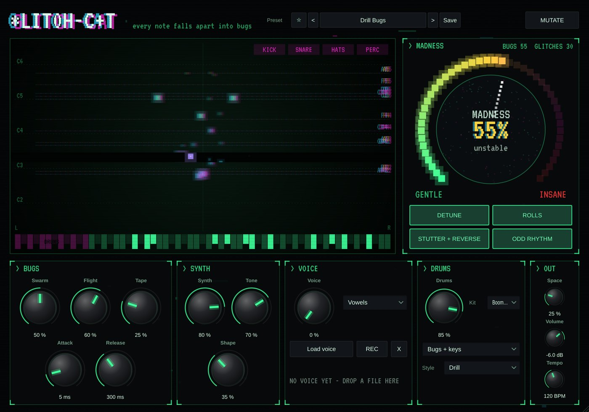

# Glitch-Cat

**Instrument** · Every note falls apart into a swarm of glitching bugs.

## What it does

> An instrument with its own beat.

Every note falls apart into a **swarm of bugs** (8 per note): one **MADNESS** knob goes from a warm, wobbly pad to rolls, stutters, reversed bits and broken rhythms.

- Four switches for what madness does: **detune**, **rolls**, **stutter + reverse**, **odd rhythm**. Gentle settings stay in time; mad ones break free.
- Its **own beat** (Drill, Broken, Dust, Rave); the low keys play drums.
- **Voices** to mangle: whisper, vowels, choir, mouth, or **your own voice** (drop a sample).
- A glitch ring (repeat, reverse, tape stop, chop, pitch) on everything; a broken-screen look; 12 presets.

---
[All plug-ins](../README.md) · [Install](../Install.md) · [Every Cat can ...](../Every-Cat.md)
