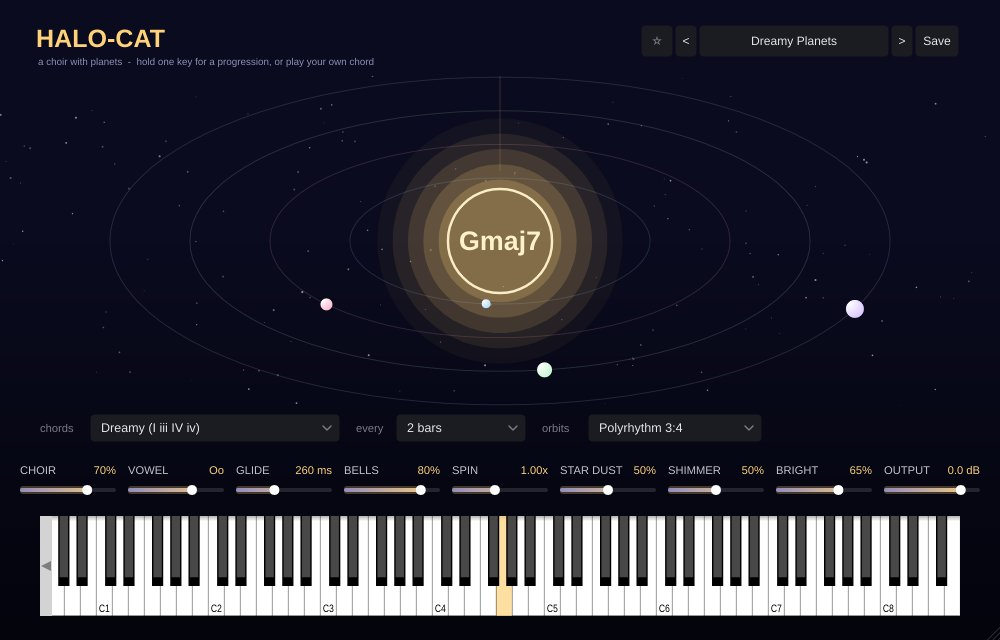

# Halo-Cat

**Instrument** · A singing choir with planets that ring bells.

## What it does

> Instrument (VST3 > Synth). Put it on an instrument track and hold a key.

Halo-Cat mixes the ideas of the recommended Cats into one instrument:

- **Hold ONE key** and it plays a whole **chord progression** in that key (Chord-Cat): Pop, Dreamy, Epic, Minor Night, Andalusian, Floating, Jazz, or Hold one chord. A new chord every 1, 2 or 4 bars, in time with your DAW.
- **Hold several keys** and that is the chord.
- A **choir** sings it (Sing-Cat): three slightly detuned voices per note through two vowel resonances - **Ah, Oh, Oo, Ee**. When the chord changes every voice **glides** to the nearest new note (Glide-Cat's voice leading).
- **Four planets** orbit the choir (Orbit-Cat). Each time one passes the top it rings a **bell** on one of the chord's notes, so the orbits make the pattern (Patt-Cat). Orbit sets: Waltzing, Calm, Busy, Polyrhythm 3:4, Sparse; **SPIN** speeds them up or down.
- **Star dust**: tiny high pings on the chord's notes at random (Swarm), and **SHIMMER**: a big hall around it all.
- Without the DAW playing it keeps its own time.

12 presets: Halo, Cathedral Night, Dreamy Planets, Epic Sky, Music Box Galaxy, Floating Monks, Andalusian Moon, Late Night Jazz, Busy Little Stars, Ee Choir, Slow Orbit, Only Bells.

**Tips:** hold one low key through a whole intro with **Floating Monks**; **Music Box Galaxy** for a lullaby; record its audio and put **Gate-Cat** on it for a trance pad.

---
[All plug-ins](../README.md) · [Install](../Install.md) · [Every Cat can ...](../Every-Cat.md)
