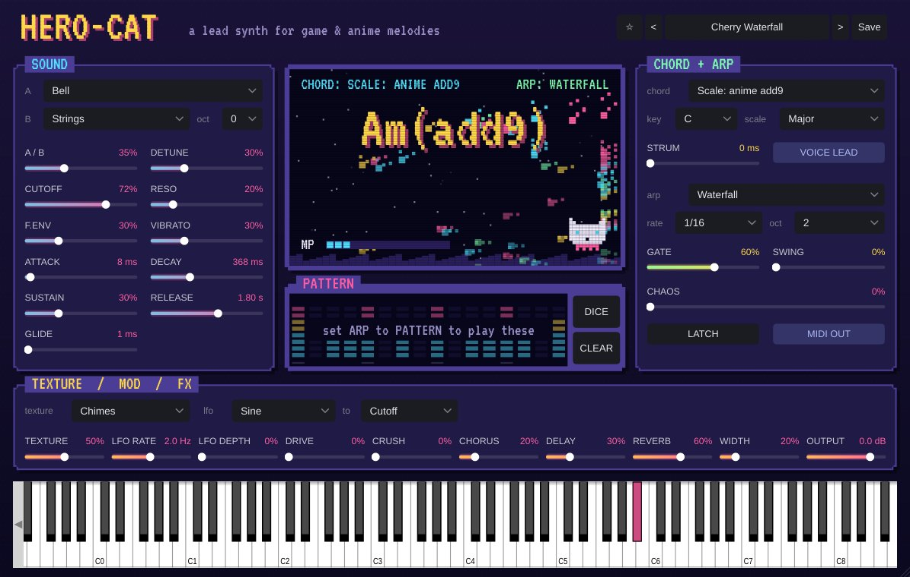

# Hero-Cat

**Instrument** · A lead synth for 90s game and anime melodies.

## What it does

> Instrument (VST3 > Synth). Put it on an instrument track and play. It can also send the notes it plays to the DAW (MIDI OUT).

- **Two sounds per note (A and B)**, mixed with **A / B**, B can be an octave lower or higher:
  - synth waves: **Saw Lead**, **Square**, **Supersaw**, **Chip Pulse**;
  - small physical models, no samples: **Guitar** (a plucked string), **Strings** (a bowed string), **Flute** (breath and a "chiff"), **Choir** ("Ah"), **Bell** (FM).
- Filter with its own envelope, ADSR, **glide** and a **delayed vibrato** (the singer's wobble that comes in after a moment, like an anime lead).
- **Chord Lock**: one key becomes a chord:
  - from the song's **key and scale** (Major, Minor, Dorian, Mixolydian, Harmonic minor, Pentatonic, Japanese In): triads, 7ths or the **anime add9**; keys outside the scale snap into it;
  - or always one shape: Major, Minor, Sus2, Power, Maj7, Min7.
  - **STRUM** spreads the notes like a guitar (up to 120 ms); **VOICE LEAD** moves every upper note to the nearest note of the last chord.
- **Arp**: Up, Down, Up-Down, Random, **Waterfall** (falls from the top and every note keeps ringing - a wash), **Pattern** (16 steps you draw, each with its own loudness; **DICE** for a new one). Rate 1/4 .. 1/32 and triplets, octaves, gate, swing, **latch**. In time with the DAW, or on its own clock when the DAW is stopped.
- **CHAOS**: the arp improvises - rests, octave jumps, double hits, other chord notes, and the filter wanders.
- **Texture** under everything: rain, birds, a quiet room, **wind chimes that play your chord**, wind.
- **LFO**: six shapes (sine, triangle, saw, square, random, bounce) on cutoff, pitch, pan, A/B mix, crush or volume.
- **FX**: drive, crush (an old console), chorus, delay (dotted 1/8, left-right), reverb, width.

16 presets: Hero Theme, Neon Supersaw, Overworld Flute, Cherry Waterfall, Rainy Tokyo Guitar, Boss Battle, Save Point, Chip Hero, Final Stage Strings, Pixel Choir, Crystal Cave, Victory Fanfare, Lo-fi Bedroom, Moonlight Bells, Dice Dreams, Sakura Wind.

**Tips:** hold one key with **Cherry Waterfall** for an instant intro; turn **MIDI OUT** on and put Glide-Cat or Crypt on another track to play the same chords; **Japanese (In)** scale + **Moonlight Bells** for a night level.

---
[All plug-ins](../README.md) · [Install](../Install.md) · [Every Cat can ...](../Every-Cat.md)
