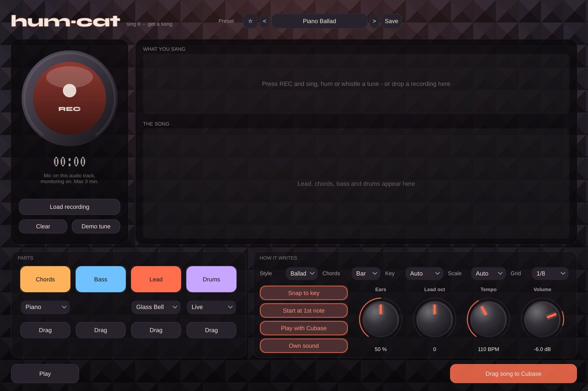

# Hum-Cat

**MIDI + sound** · Sing or hum a tune and get lead, chords, bass and drums.

## What it does

> Put it on the audio track with your microphone (press REC), or drop a recording on it (wav, mp3, aiff, flac).

Sing or hum a tune and Hum-Cat hears the notes (YIN pitch tracking), finds the key and writes a whole song around it:

- **Lead** (your tune, cleaned up), **Chords**, **Bass** and **Drums**, in 6 styles: Pop, Ballad, Hip-Hop, Rock, Lo-Fi, House.
- MIDI out on channels 1 / 2 / 3 / 10, or its **own sound**; plays with Cubase or with Play (preview).
- **Drag** the whole song or one part straight into Cubase as MIDI. A **Demo tune** to try it without singing.
- Look: a vocal booth (acoustic foam, a coral tally light).

## In Cubase

MIDI Cats load as **instruments** (Cubase's MIDI insert slots only take Steinberg's own plug-ins). See [Using it in Cubase](../Cubase.md) for the routing.

---
[All plug-ins](../README.md) · [Install](../Install.md) · [Every Cat can ...](../Every-Cat.md)
