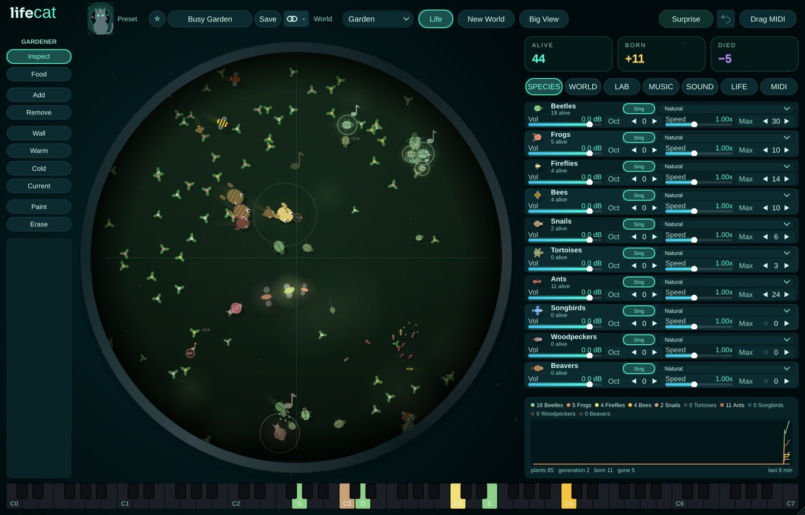

# Life-Cat

**Instrument** · A living ecosystem of animals that makes music.

## What it does

> Instrument (makes sound) + optional MIDI out, also a standalone app.

A sandbox ecosystem that makes music. **Ten kinds of animal**, each with its own behaviour and sound: grazers, hunters, drifters, pollinators (spread plants, plucks), scavengers (eat what dies, percussion), giants (deep drones), swarms (flock, arpeggios), **singers** (birds / dolphins / sirens: whole melodic phrases), **drummers** (woodpeckers / shrimps / pulsars: euclidean rhythms) and **builders** (beavers / coral crabs / bots: plant seeds, lay meadow trails, build nests). Every creature sings with a voice grown from its **29 genes**; babies blend both parents' genes plus a mutation, so the music evolves. Four worlds that change look and sound: **Garden**, **Ocean**, **Space**, **Cells**. Sandbox: drop food, add / remove animals, walls, warm / cold zones, currents, paint terrain (water, rock, meadow, sunlight, sand, lava), gravity, wind, day / night, seasons, weather you can hear, a Gene Lab to design creatures, per-species volume / octave / sound / speed / max, up to 128 creatures. Zoom with the wheel, drag to look around, follow a favourite. Notes from position, species chord tones or the chord you hold (or Chord-Cat's, via Cat Link), always in key (11 scales); grid with swing or free floating. Reverb, ping-pong delay, MIDI out on one channel or one per kind, Drag MIDI, 36 world presets, worlds are saved with the project. The Ocean world has a Frutiger Aero look (sunlight through the surface, swaying rays, caustics, glossy bubbles) and three Aero ocean worlds: Aero Lagoon, Bubble Reef, Glass Sea.

---
[All plug-ins](../README.md) · [Install](../Install.md) · [Every Cat can ...](../Every-Cat.md)
