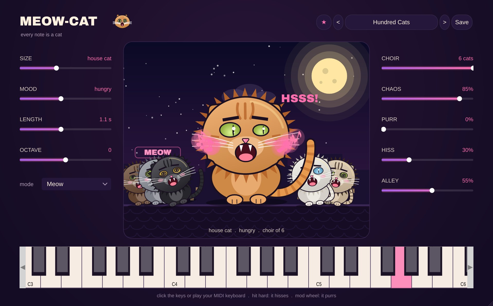

# Meow-Cat

**Instrument** · Every note is a cat: meows, a cat choir, purring and hissing.

## What it does

> Instrument (VST3 > Instrument). Load it on an instrument track and play.

Play a tune and a cat meows it. Play a chord and a choir of cats sings it. No recordings: every meow is made from scratch, a buzzing voice through four mouth resonances that move from "m" to "i" to "a" to "o" to "u" while the pitch rises and falls, so it follows any note you play and no two cats are the same.

- **SIZE**: a tiny kitten (left), a house cat, a big cat, a lion (right, with a mane and a growl).
- **MOOD**: a sweet "mew?" (left), a hungry "meeoow" in the middle, a furious, rough "mrrraaooww" with a big wobble (right). The cat's eyes and ears show it.
- **LENGTH**: a short mew or a very long meeeeooow. **OCTAVE**: the whole cat higher or lower.
- **MODE**
  - **Meow**: one meow per note (it ends by itself, like a real cat).
  - **Sing**: holds the "aaa" while you hold the key, in tune, and says "ow" when you let go - for melodies.
  - **Chatter**: the "ek-ek-ek" of a cat watching birds through the window, in 1/16 notes with your song.
  - **Purr**: only purring (about 25 pulses a second, breathing in and out).
- **CHOIR**: 1 .. 6 cats on every note, each a bit different (bigger, smaller, a bit out of tune, a bit late, left or right). They sit next to the singer on the roof.
- **CHAOS**: every meow a bit different, and now and then the voice cracks.
- **PURR**: a purr under every held note. The **mod wheel** purrs too.
- **HISS**: hit a key hard and the cat hisses instead (left = never).
- **ALLEY**: the echo of a back alley at night.
- The keyboard at the bottom plays it with the mouse. Pitch bend, the sustain pedal and all-notes-off work.

22 presets: House Cat, Tiny Kitten, Hungry at 6 AM, Cat Choir, Opera Cat, Kitten Choir, Midnight Serenade, Alley Fight, Hiss!, Lion King, Big Cat Sings, Siamese, Purring on Your Lap, Sleepy Cat, Birds at the Window, Chatter Choir, Hundred Cats, Broken Cat, Cat Bass, Squeaky Toy, Grumpy Old Tom, Space Cats.

**Tips:** a melody with **Opera Cat** (play legato); chords with **Cat Choir** or **Kitten Choir**; **Birds at the Window** as a funny hi-hat; **Cat Bass** for a bass line nobody expects; a drum beat with **Hiss!** on the loud hits.

---
[All plug-ins](../README.md) · [Install](../Install.md) · [Every Cat can ...](../Every-Cat.md)
