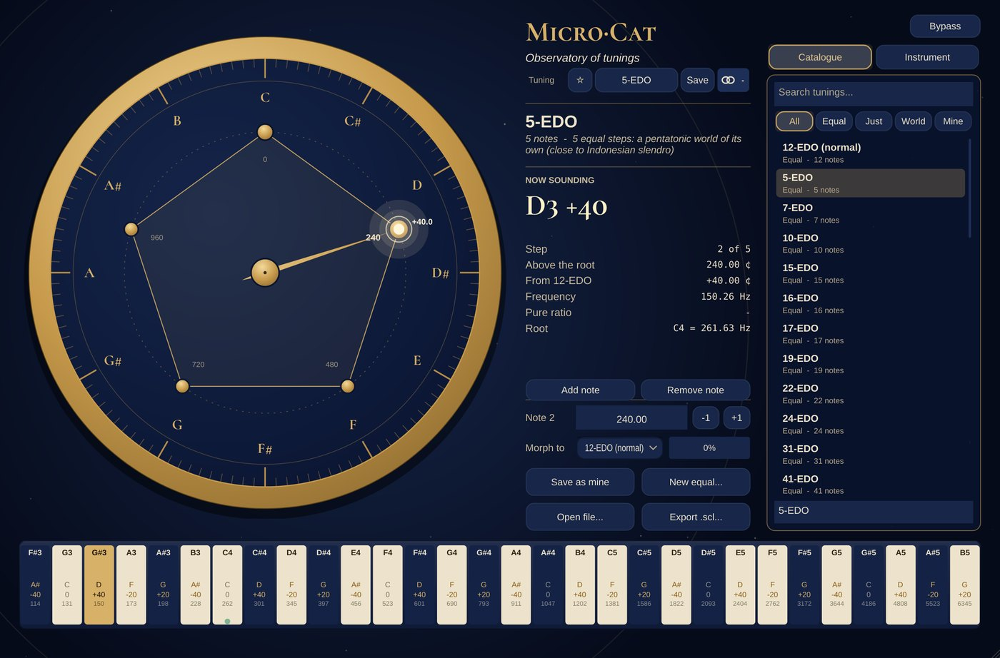

# Micro-Cat

**MIDI + sound** · Microtonal tunings: 37 tunings, its own sound, MPE and MTS-ESP.

## What it does

> MIDI effect (microtonal tunings), like Ableton's tuning systems but for any MPE synth in your DAW.

A tuning browser with search and 37 tunings: **equal** (5, 7, 10, 15-17, 19, 22, 24, 31, 41, 53, 72-EDO, Bohlen-Pierce, Carlos Alpha), **just & historical** (5- and 7-limit just intonation, Pythagorean, 1/4-comma meantone, Werckmeister III, Kirnberger III, Vallotti, Young, harmonic series, Ptolemy) and **world** (maqam Rast, Bayati, Saba, Sikah, Turkish Arel-Ezgi, Indian 22 shruti, gamelan slendro and pelog, Thai, Chinese pentatonic, koto). A **tuning circle** editor: drag notes round the circle, type exact cents, add / remove notes, start from any equal tuning, save as *My tunings*, open / export **Scala .scl** files. Root key and its frequency (A4 = 440 or anything), keys as *one key per step* (19-EDO = 19 keys an octave) or a *12-key layout* (a C stays on C), a keyboard showing what every key really plays (nearest note, cents, Hz); click a key to hear it. Opens Ableton **.ascl** files too (their reference pitch sets the root). **No routing for Glide-, Sing- and Talk-Cat**: they play in Micro-Cat's tuning straight away over **Cat Link**. **MTS-ESP master**: one tuning for every MTS-ESP synth in the project (Surge XT, Vital, Pigments, Serum 2, u-he, Kontakt ...) like Ableton - the installer offers ODDSound's free MTS-ESP library. Out: **MPE**, every note on its own channel (up to 15 voices) with its pitch bend, the MPE set-up (Configuration Message + bend range 2 / 12 / 24 / **48** / 96), sustain and wheel on the master channel, poly aftertouch on the note's own channel. In your DAW: load it, route its MIDI Out to a synth in MPE mode with the same bend range (Vital, Surge XT, Serum, Pigments, Retrologue / Padshop in MPE mode ...).

## In your DAW

MIDI Cats load as **instruments with a MIDI output**: the DAW sends that MIDI to your synth (in Cubase, MIDI insert slots only take Steinberg's own plug-ins). See [Using it in your DAW](../DAW.md) for the routing.

---
[All plug-ins](../README.md) · [Install](../Install.md) · [Every Cat can ...](../Every-Cat.md)
