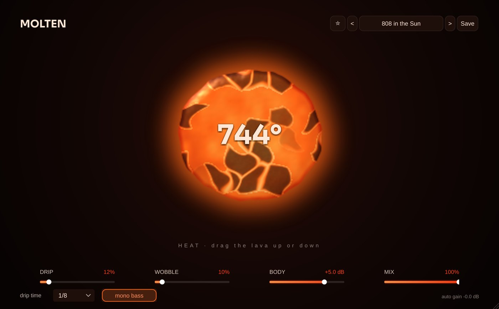

# Molten

**Effect** · Melts any sound into something warm and fat (HEAT, DRIP, WOBBLE).

## What it does

> Audio effect (VST3 > Distortion).

Melts any sound into something warm and fat, for 808s, basses, synths and whole mixes (EDM, trap). **HEAT** (drag the lava up or down, 0 ... 1200°): warm valve-like saturation, 2x oversampled, that gets dirtier and darker the hotter it is but never louder (auto gain keeps the level). **DRIP**: bits of the sound drip off and fall, echoes in time with the DAW that get lower and darker every time. **WOBBLE**: the pitch sags and wobbles like warm tape, more when it is loud and hot. **BODY** (low end), **MIX**, mono bass (everything under 120 Hz stays in the middle). The screen is a real lava simulation: a glowing blob that sags, cracks its crust, breathes with the sound and drips with every echo. 13 presets (808 in the Sun, Reese Lava Lamp, Phonk Furnace, Supersaw Meltdown, Wax Tape Bus, Total Meltdown ...).

---
[All plug-ins](../README.md) · [Install](../Install.md) · [Every Cat can ...](../Every-Cat.md)
