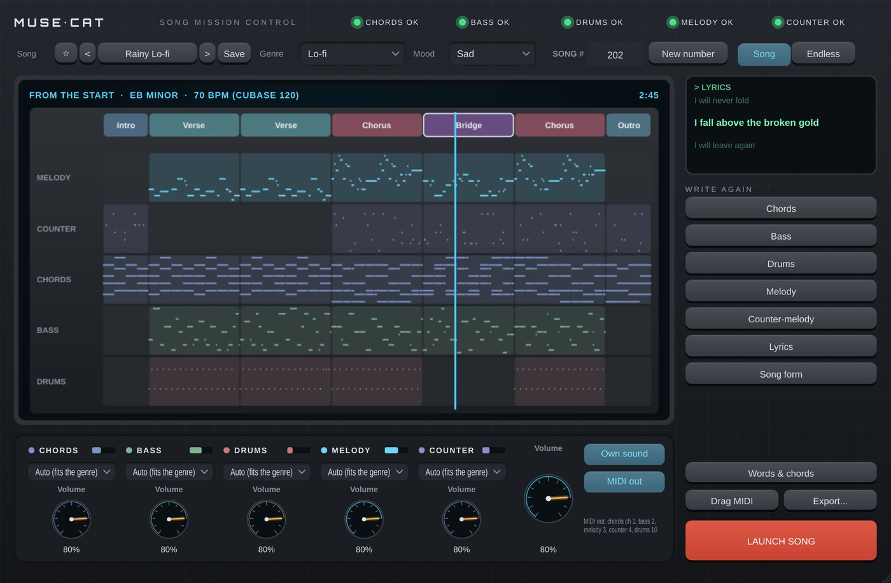

# Muse-Cat

**Instrument** · Writes whole songs (or endless music) and plays them.

## What it does

> Instrument (makes sound) + MIDI out, also a standalone app.

Writes whole songs from a genre, a mood and a song number, or endless music (see *The composer* below). Plays them with its own sounds (pick one per part) and sends every part as MIDI: chords ch 1, bass ch 2, melody ch 3, counter-melody ch 4, drums ch 10, so other Cats or synths can play them. Follows Cubase's transport (or its own Play button); New buttons per part, a song map with the playhead, the words, Drag MIDI (all parts, with the words as MIDI lyric events) or drag one part's lane / name for just that part, click a section to arrange the song (other chords, change its type or length, which parts play, add / move / remove sections, undo; saved with the project), **Words & chords**: type your own chords for the verse, chorus, pre-chorus and bridge (by name, *C Am7 F#m Bbmaj7 G7*, or by number in the key, *I vi IV V7*, up to 16 each; the melody, bass and counter-melody re-fit to them) and your own words (one line per sung line, one syllable per note, *mor-ning* to split a word your way), saved with the project; export WAV / stems / MIDI, 13 song presets.

---
[All plug-ins](../README.md) · [Install](../Install.md) · [Every Cat can ...](../Every-Cat.md)
