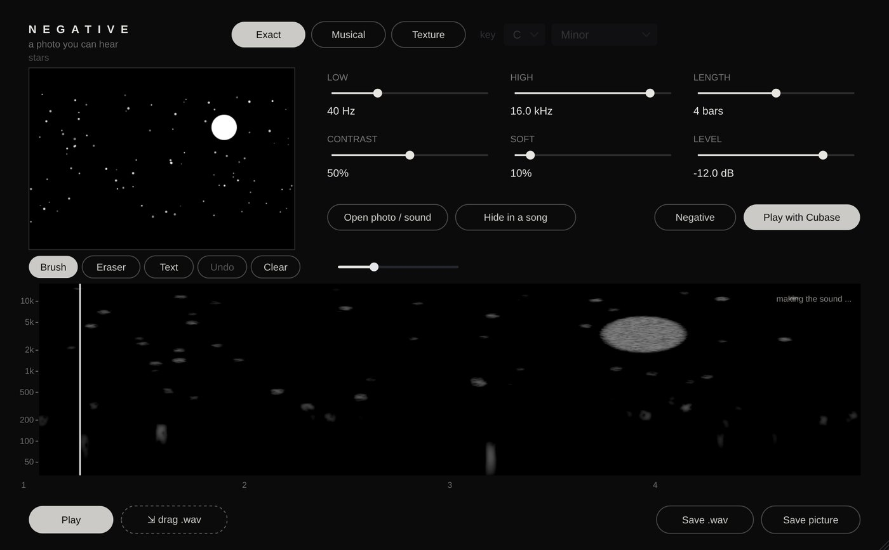

# Negative

**Instrument + program** · A photo you can hear: photo to spectrogram to sound.

## What it does

> A tool: a photo you can hear (VST3 instrument, and a program: Negative.exe).

A photo becomes sound, and the sound's spectrogram shows the photo (time left to right, pitch bottom to top). **EXACT** (every pixel is the loudness of one frequency: the photo comes out sharp, it sounds like air), **MUSICAL** (the photo plays notes of a key: bright spots are notes, bright areas chords), **TEXTURE** (a soft pad). LOW / HIGH (which frequencies it uses), LENGTH (1 ... 16 bars at Cubase's tempo), CONTRAST, SOFT, NEGATIVE (inverted), LEVEL. In Cubase it is an instrument: it plays in time with the song and on MIDI notes (C4 = as it is) - put LOW / HIGH up high and LEVEL down and the photo hides in your song, visible only in a spectrogram. Paint on it: **Brush**, **Eraser**, **Text** (type it, pick one of 17 fonts and a size, click where it goes), **Undo**, **Clear**; **Open photo / sound** (a sound becomes the photo: its spectrogram), **Hide in a song** (or drop files: on top = the photo, on the spectrogram = the song), **Save .wav** / drag the .wav onto a track, **Save picture** (the spectrogram as a .png).

---
[All plug-ins](../README.md) · [Install](../Install.md) · [Every Cat can ...](../Every-Cat.md)
