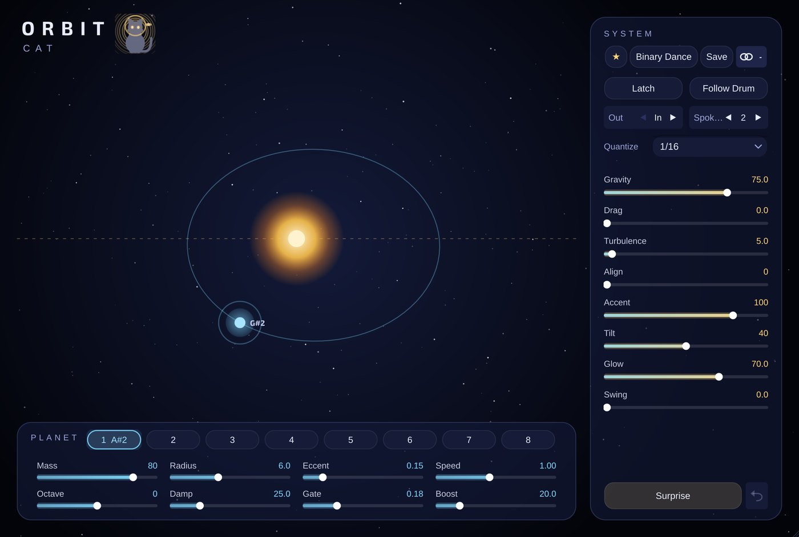

# Orbit-Cat

**MIDI** · An arpeggiator where every note is a planet on an orbit.

## What it does

Orbital-physics arpeggiator: every held note is a planet (Kepler orbits, eccentricity, mutual pull, drag, turbulence) and plays when it crosses an alignment spoke; per-note mass / radius / eccentricity / speed / octave / damping / gate / boost, quantize, 32 presets, animated orbit display.

## In Cubase

MIDI Cats load as **instruments** (Cubase's MIDI insert slots only take Steinberg's own plug-ins). See [Using it in Cubase](../Cubase.md) for the routing.

---
[All plug-ins](../README.md) · [Install](../Install.md) · [Every Cat can ...](../Every-Cat.md)
