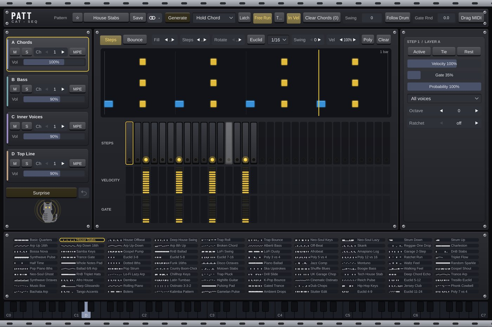

# Patt-Cat

**MIDI** · A 4-layer step sequencer for held chords, plus bouncing notes.

## What it does

4-layer step sequencer for held chords: 32 steps per layer with velocity / gate / tie / rest / ratchet / probability / voice select, Euclidean generator, polyrhythms, 80 preset patterns. **Bounce** page: every note bounces like a ball (shown as cats jumping over a keyboard) and re-plays on each bounce.

## More

### Bounce (Steps / Bounce switch above the grid)
- *Bounce* = Off, Pattern Notes (every note Patt-Cat plays bounces) or Keys (every key you press bounces on its own, alongside the pattern; mute layer A to hear only the bounces).
- The first gap is Rate (a note value at the song tempo, R.Mode Sync) or Time (ms, R.Mode Free). Curve + makes each gap shorter like a real ball (up to x0.55 per bounce), Curve - slows the bounces down. Notes = number of bounces, Fade Out = how much quieter the last bounce is, Octave / Oct Rnd move the bounces, Dur = note length, Human = random timing.
- Play: One Shot plays every bounce; While Held stops the remaining bounces when you let go of the key.

## In your DAW

MIDI Cats load as **instruments with a MIDI output**: the DAW sends that MIDI to your synth (in Cubase, MIDI insert slots only take Steinberg's own plug-ins). See [Using it in your DAW](../DAW.md) for the routing.

---
[All plug-ins](../README.md) · [Install](../Install.md) · [Every Cat can ...](../Every-Cat.md)
