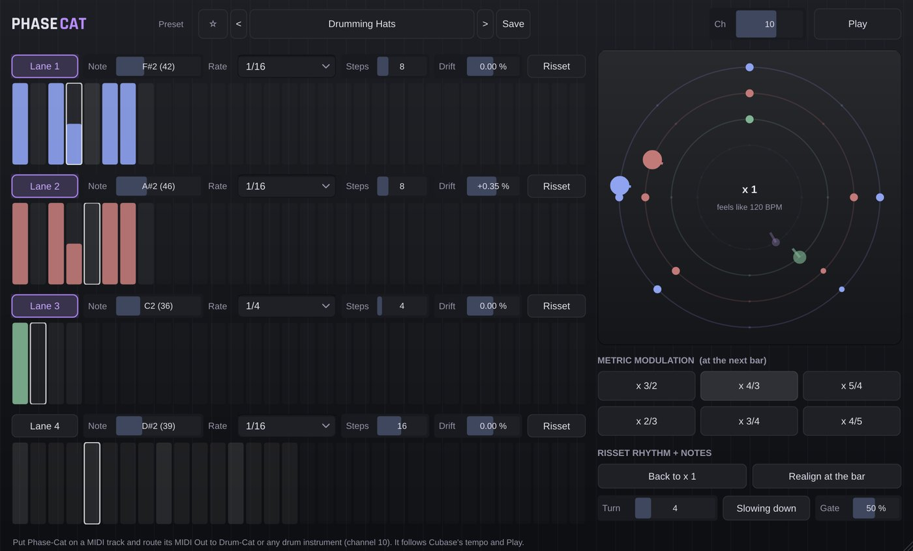

# Phase-Cat

**MIDI** · Drifting, phasing rhythms (Steve Reich, Risset) for drums.

## What it does

> MIDI out (drum notes, channel 10 by default) to Drum-Cat or any drum instrument.

Experimental rhythm: **four lanes** of steps, each its own little world.

- **Polymeter:** every lane has its own length (1 - 32 steps): 3 against 4 against 5 against 7 only comes round together after a long time.
- **Phasing** (Steve Reich): a lane runs a little faster or slower than the others (DRIFT, in %); two lanes with the same pattern slide apart step by step and meet again.
- **Risset rhythm:** a lane plays in three tempo layers an octave apart whose loudness follows a bell curve; the tempo glides up (or down) and loops: a beat that seems to speed up forever but never gets faster.
- **Metric modulation:** one click and, at the next bar, the lanes' beat is multiplied by 3/2, 4/3 ... (triplets become the new eighths) while Cubase's tempo stays the same.
- Per lane: on / off, length, drum note, rate, drift, Risset; gate, MIDI channel, Risset turn length and direction.

## In Cubase

MIDI Cats load as **instruments** (Cubase's MIDI insert slots only take Steinberg's own plug-ins). See [Using it in Cubase](../Cubase.md) for the routing.

---
[All plug-ins](../README.md) · [Install](../Install.md) · [Every Cat can ...](../Every-Cat.md)
