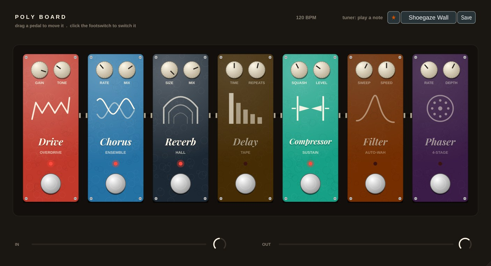

# Poly Board

**Effect + program** · A pedalboard for your synth (made with the Behringer Poly D in mind).

## What it does

> In a DAW: put it on the audio track of your synth (VST3 > Effect). Live without a DAW: open the **Poly Board app**, pick your sound card in *Options > Audio settings* and turn the input on.

Seven boutique pedals in one chain. Drag a pedal sideways to change the order, click its footswitch to switch it on or off. Each pedal's picture moves with what it is doing.

| Pedal | What it does | Knobs |
|---|---|---|
| **Drive** | pushes the sound into a soft clipper: the round wave gets flat tops = warm overtones | Gain, Tone |
| **Compressor** | turns loud notes down: everything even, notes ring longer | Squash, Level |
| **Filter** | an auto-wah: a resonant filter opening and closing in time with the song | Sweep, Speed (4 bars .. 1/16) |
| **Phaser** | phase-shifted copies cancel a few frequencies that sweep: the 70s swoosh | Rate, Depth |
| **Chorus** | two slightly late, wobbling copies: wide and thick | Rate, Mix |
| **Delay** | echoes in time with the song (1/16 .. 1/2, dotted), left-right, each darker | Time, Repeats |
| **Reverb** | a room: small .. huge hall | Size, Mix |

- **Tuner** at the top: an analog synth like the Poly D drifts - play a note and tune it (green = in tune).
- **MIDI footswitch:** CC 80 .. 86 switch the pedals by their place on the board (80 = the first). A program change picks a preset.
- **IN / OUT** at the bottom: the levels and two small knobs (input gain, output volume).
- 12 presets: Clean Shine, Seventies Lead, Funky Wah Bass, Disco Phaser, Wide Strings, Dub Echo, Space Pad, Dirty Bass, Acid Squelch, Shoegaze Wall, Tight & Punchy, Everything On.

**Tip:** the order changes the sound - Drive *before* Reverb is a dirty sound in a room; Reverb *before* Drive is a dirty, huge wash (Shoegaze Wall).

---
[All plug-ins](../README.md) · [Install](../Install.md)
