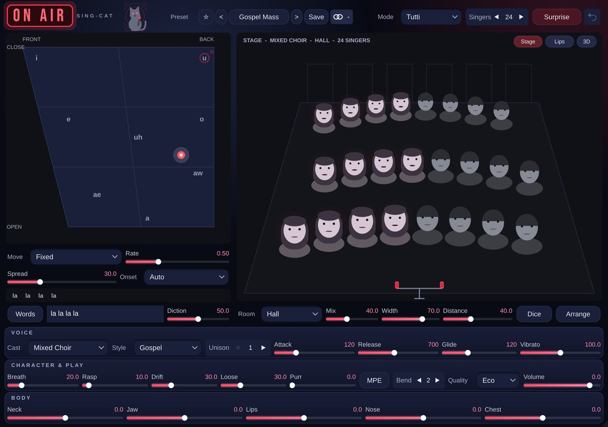

# Sing-Cat

**Instrument** · A physically modelled choir of people and cats.

## What it does

> Instrument (makes sound).

A physically modelled choir of people and cats, up to 64 singers. Each singer has a glottis (tension, breath, jitter, rasp) feeding a vocal tract and nasal cavity. Includes 14 casts (men, women, children, elders, kittens, tomcats, opera stars, families, mixed); Neck / Jaw / Lips / Nose / Chest body controls; 13 styles (Classical, Gospel, Pop, Folk, Jazz, Breathy, Pansori, Opera, Bulgarian, Soul, Robot, Lullaby, Chant); and Solo (legato) / Choir / Tutti modes with MPE. The vowel chart supports Wave / Envelope / Steps / drawn Path / Random movement. Singers stand on a stage you arrange, in a modelled room, and their faces sing with their mouths. Also: meows, purring, breathing, 48 presets. Aero presets (Aero Choir, Ocean Ooh, Glass Ahh, Sky Whisper, Bubble Pop Duo). The voice source is band-limited, so high voices sound clean instead of buzzy.

---
[All plug-ins](../README.md) · [Install](../Install.md) · [Every Cat can ...](../Every-Cat.md)
