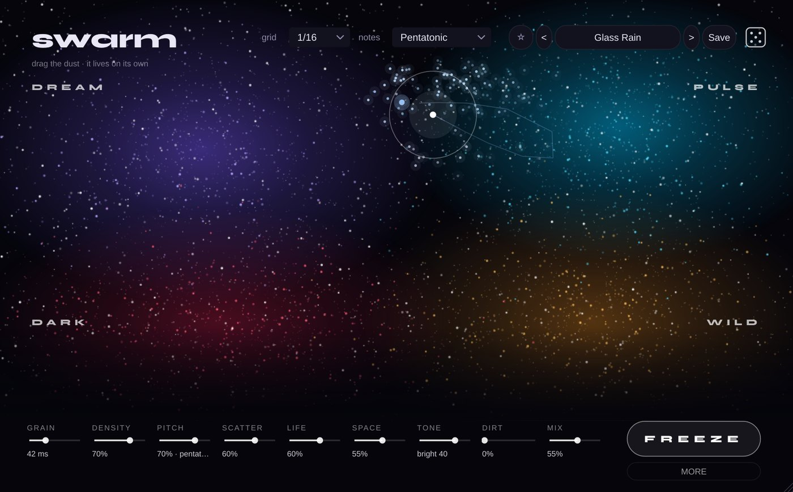

# Swarm

**Effect** · A granular organism: the sound becomes a living cloud of grains.

## What it does

> Audio effect (VST3 > Modulation), a granular organism.

The sound is cut into tiny grains and a swarm of them plays it back as a texture. **Drag the point on the nebula**: **DREAM** (long soft grains, an octave up, a big space), **PULSE** (short chops in time with the DAW: 1/32 ... 1/4, triplets), **DARK** (an octave down, murky and dirty), **WILD** (random sizes, jumps, everywhere); in between they blend. **LIFE** makes it alive: it wanders round your point on its own (a slow chaotic attractor), breathes faster when the sound is loud and digs up bits from seconds ago. GRAIN (2 ms micro fizz ... 0.8 s smears), DENSITY, PITCH (octaves, fifths or the notes of a scale: major, minor, pentatonic, dorian, lydian, phrygian), SCATTER, SPACE (echo + a big reverb), TONE, DIRT, MIX. **FREEZE** holds the last bit of sound and plays it forever. The lows under 120 Hz never go through the swarm (they stay dry and solid), auto gain keeps the level. Every grain is a spark on the screen. 35 presets (for vocals, pads, leads, drums, the whole mix, micro fizz) and a dice for new sounds. **MORE** opens the finer controls: SHAPE (soft or chopped), REVERSE, UP / DOWN, DETUNE, WIDTH, REACH, LIFE SPEED, ECHO + its time, reverb SIZE, DUCK (the swarm steps back while the sound plays) and where the dry lows end (60 ... 250 Hz).

---
[All plug-ins](../README.md) · [Install](../Install.md) · [Every Cat can ...](../Every-Cat.md)
