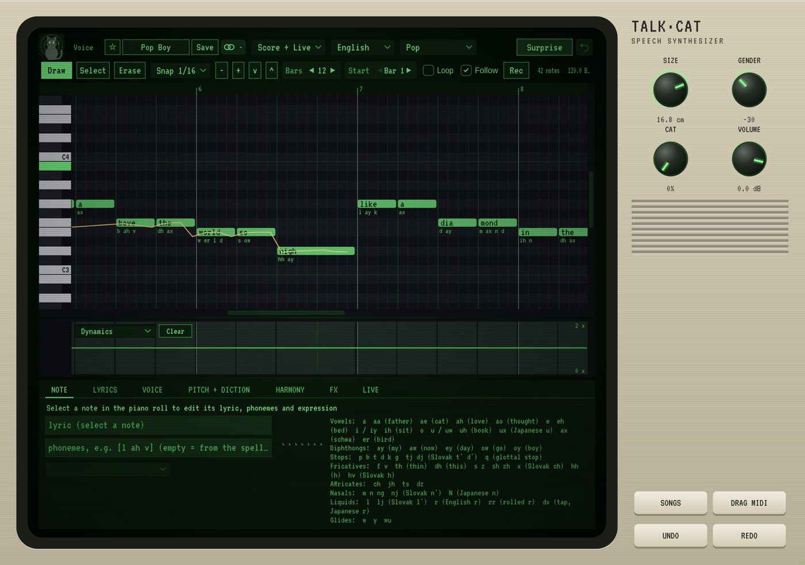

# Talk-Cat

**Instrument** · A vocaloid-style singer with lyrics (English, Slovak, Japanese, cat).

## What it does

> Instrument (makes sound).

A vocaloid-style lead singer, human or cat, with its own **piano roll**. Draw notes, type a lyric on each (double-click; Tab jumps to the next note; several words fill the following notes), or paste a whole song text into LYRICS. Sings **English** (dictionary + spelling rules), **Slovak** (č š ž ť ď ň ľ, ia/ie/iu/ô, syllabic r/l), **Japanese** romaji (ka shi tsu, kya, n, small tsu) and **Cat** (meow, mrrp, purr, hiss, nya, yowl, chirp, trill). Exact pronunciation as phonemes in brackets, e.g. [l ah v]. Consonants start before the beat so the vowel lands on it. 10 drawable curves (pitch bend, dynamics, breath, brightness, gender, tension, growl, vibrato, cat, mouth); per-note velocity, portamento, vibrato and consonant length. Voice designer (size, gender, age, human-to-cat morph, breath, tension, rasp, nasal, ring, jaw, lips, tongue, throat) with a live vocal-tract view; 15 singing styles; double track + 3 diatonic harmonies; tone, compressor, drive, delay, reverb. Live mode: MIDI notes sing the next syllable of the live lyrics, and can be recorded into the roll. MIDI import/export with lyrics, 6 demo songs, 33 voice presets. The voice source is band-limited (about 35 dB less aliasing), so high and cat voices sound smooth instead of buzzy.

---
[All plug-ins](../README.md) · [Install](../Install.md) · [Every Cat can ...](../Every-Cat.md)
