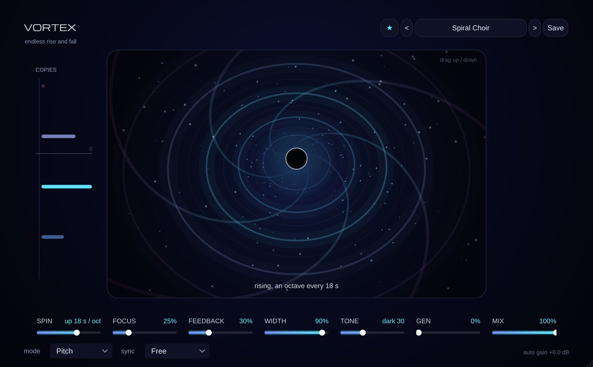

# Vortex

**Effect** · The sound rises (or falls) forever: an endless Shepard spiral.

## What it does

> Audio effect (VST3 > Pitch Shift). Put it on any audio track or a group.

You know the sound in films where the tension keeps rising and never arrives? That is a **Shepard tone** (Risset's glissando): copies of the sound an octave apart all glide up, the top one fades out while a new one fades in at the bottom, so your ear only hears "higher, higher, higher". Vortex does that to **any sound**.

- **Drag up / down on the vortex** (or SPIN): right = rising, left = falling, the middle stands still. The rings fly out of the middle while it rises and into it while it falls.
- **PITCH**: 4 pitch-shifted copies of the sound, an octave apart, glide forever. **FILTER**: 10 filters an octave apart sweep through the sound (a "barber pole" filter, also great as an endless phaser at MIX 50%). **BOTH**: one after the other.
- **SYNC**: one octave every 1, 2, 4, 8 or 16 bars, locked to the song position in Cubase (a riser that is always in the same place in the bar). With SYNC on, SPIN only picks the direction.
- **FOCUS**: high = fewer, clearer copies; low = a thick cloud. **FEEDBACK**: what comes out goes round again an 1/8 note later and spins further (cascades, waterfalls). **WIDTH**, **TONE** (dark .. bright), **MIX**.
- **GEN**: an endless Shepard tone of its own. It plays even when nothing comes in, so Vortex is also a riser / faller generator.
- Auto gain keeps it as loud as what came in, and the safety limiter keeps it under 0 dB.
- The ladder on the left shows where the copies (or filters) are now and how loud each one is.

24 presets: Endless Rise / Fall, Tension Riser (8 bars), Drop Builder (4 bars), Barber Pole, Phaser Spiral, Cascade, Waterfall, Spiral Choir, Black Hole, Shepard Tone, Infinite Organ, Down the Drain and more.

**Tips:** a pad or a choir through **Spiral Choir**; a whole build-up through **Tension Riser (8 bars)** with the automation of MIX; drums through **Phaser Spiral**; **Shepard Tone** on an empty audio track for an endless riser under a drop.

---
[All plug-ins](../README.md) · [Install](../Install.md) · [Every Cat can ...](../Every-Cat.md)
